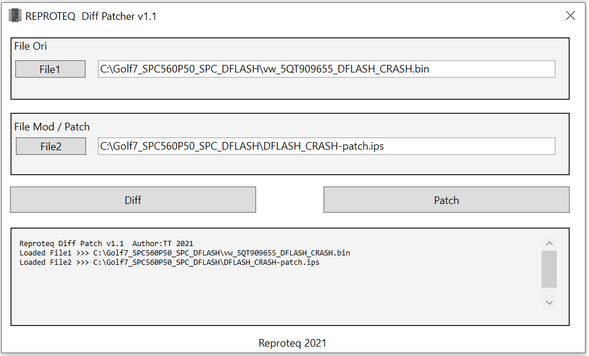

# DiffPatchWpf

DiffPatchWpf  simple binary patch maker tool.
 
Compare two binary files and save the differences between them in new file patch.txt

Apply the patch in another binary fast and easy.

Now you can apply the differences in another binary quickly and easily.

example:
 
 
1- Load file Aori.bin

2- Load file Amod.bin

3- Compare and save Aori-patch.txt

4- Load file Bori.bin

5- Load patch Aori-patch.txt

6- Apply patch and save file Bori-patched.bin

 

https://youtu.be/EpyuF4t5MWk

Microsoft Visual Studio Community 2019

Versión 16.7.7

.NETFramework,Version=v4.7.2

Tested in windows 10x64bits

Donations btc

1Mmwhdw4mQzbuLbmPFdEF2uXMVi8X3kv68

paypal 

reproteq@gmail.com

# ☕ Apoya mi trabajo

Si encuentras útil este proyecto y te gustaría apoyar su desarrollo, considera hacerme una donación. ¡Cualquier cantidad es bienvenida y muy apreciada!

| Monto | Enlace de Donación |
| :---: | :---: |
| **1€** | [Donar 1€](https://www.paypal.com/cgi-bin/webscr?cmd=_donations&business=reproteq@gmail.com&item_name=Apoyo+al+Proyecto&amount=1.00&currency_code=EUR) |
| **5€** | [Donar 5€](https://www.paypal.com/cgi-bin/webscr?cmd=_donations&business=reproteq@gmail.com&item_name=Apoyo+al+Proyecto&amount=5.00&currency_code=EUR) |
| **10€** | [Donar 10€](https://www.paypal.com/cgi-bin/webscr?cmd=_donations&business=reproteq@gmail.com&item_name=Apoyo+al+Proyecto&amount=10.00&currency_code=EUR) |
| **25€** | [Donar 25€](https://www.paypal.com/cgi-bin/webscr?cmd=_donations&business=reproteq@gmail.com&item_name=Apoyo+al+Proyecto&amount=25.00&currency_code=EUR) |
| **50€** | [Donar 50€](https://www.paypal.com/cgi-bin/webscr?cmd=_donations&business=reproteq@gmail.com&item_name=Apoyo+al+Proyecto&amount=50.00&currency_code=EUR) |
| **100€** | [Donar 100€](https://www.paypal.com/cgi-bin/webscr?cmd=_donations&business=reproteq@gmail.com&item_name=Apoyo+al+Proyecto&amount=100.00&currency_code=EUR) |
| **Monto Libre** | [Donar Otro Monto](https://www.paypal.com/cgi-bin/webscr?cmd=_donations&business=reproteq@gmail.com&item_name=Apoyo+al+Proyecto&currency_code=EUR) |

